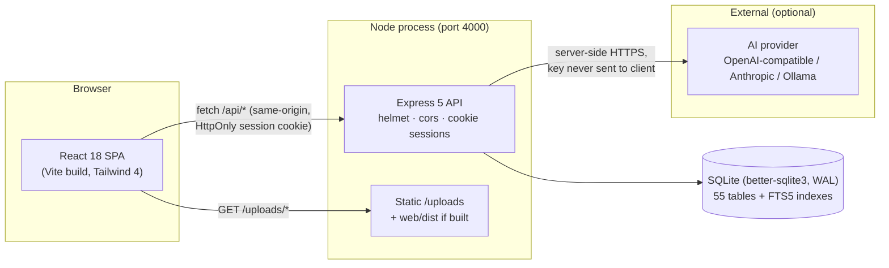
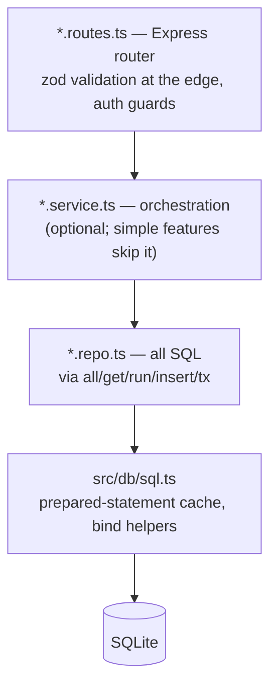
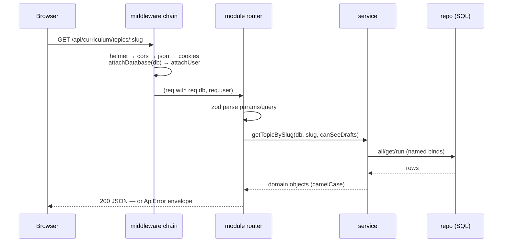
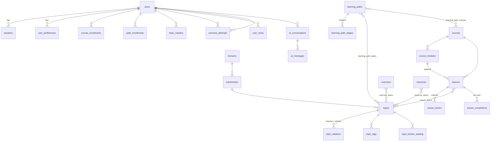
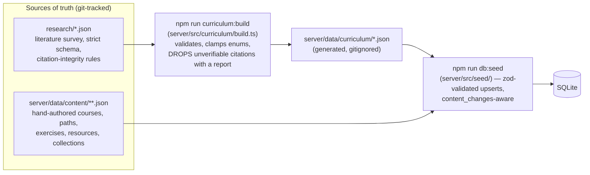

# Architecture

How AI Mastery is built. For the *why*, see [PROJECT_OVERVIEW.md](PROJECT_OVERVIEW.md); for
binding coding rules, see [CONVENTIONS.md](CONVENTIONS.md) and the root [AGENTS.md](../AGENTS.md).

## System shape

One Node process serves the API and (when built) the SPA. One SQLite file holds everything.
The only external dependency at runtime is the optional AI provider.

- In development, Vite (port 5173) serves the SPA and proxies `/api` and `/uploads` to the API
  (port 4000); in production the API serves `web/dist` itself ([app.ts:52](../server/src/app.ts)).
- **No ORM.** better-sqlite3 with hand-written SQL; all queries run through the helpers in
  [server/src/db/sql.ts](../server/src/db/sql.ts), which memoize prepared statements per
  connection.

## Server layering

Every module under `server/src/modules/<feature>/` follows the same three layers. SQL appears
only in `*.repo.ts` files.

- **HTTP plumbing** ([server/src/lib/http.ts](../server/src/lib/http.ts)): `handler()` wraps
  route functions; every error is an `ApiError` and leaves as the envelope
  `{ error: { code, message, details } }` where `details` carries field-level validation text
  (`[{ field, message }]`). Routes never construct error JSON by hand.
- **Auth guards**: `requireAuth`, `requireStaff` (author/admin), `requireAdmin`; identity comes
  from the `attachUser` middleware reading the session cookie ([app.ts:44](../server/src/app.ts)).
- **Full route surface**: [server/src/routes.ts](../server/src/routes.ts) mounts 15 routers
  under `/api` (auth, curriculum, dashboard, courses, paths, learning, arena, library, progress,
  notes, ai, research, events, search, admin).

## Request lifecycle

## Database

SQLite with `PRAGMA foreign_keys = ON` and WAL ([connection.ts](../server/src/db/connection.ts)).
Schema is versioned by checksummed migrations `0001`–`0004` in
[server/src/db/migrations/](../server/src/db/migrations/) — applied migrations are never edited;
new schema work is a new migration (see `0003`/`0004` for the pattern). Timestamps are ISO-8601
UTC text; internal PKs are integers with stable public `slug`s; ordered string lists live in
JSON columns validated at the edge.

Core relationships (simplified; 55 tables total):

Points worth knowing:

- **Drafts never leak**: every learner-facing query filters `status = 'published'`; staff see
  drafts via a `canSeeDrafts` flag derived from the session role.
- **Search** ([0002_search_fts.sql](../server/src/db/migrations/0002_search_fts.sql)) is FTS5
  with *external-content* indexes kept in sync by triggers, ranked with `bm25()` and per-column
  weights. Search never reads a stale copy because the index is trigger-maintained, not copied
  at query time.
- **Two audit/feed tables**: `activity_log` (a learner's study feed) and `content_changes`
  (staff edits; actor name denormalised so account deletion cannot erase history) —
  [0004_admin_audit.sql](../server/src/db/migrations/0004_admin_audit.sql).

## Content pipeline

Educational content is data with two sources of truth and a one-way build step:

Rules that follow from this shape:

- Edit only `research/*.json` or `server/data/content/**`; never `server/data/curriculum/**`.
- The seeder dedupes citation rows by normalised URL — changing a URL creates a new row rather
  than mutating one, so re-running seed does not undo published history.
- `npm run db:reset` is destructive: drop → migrate → seed.

## Auth and security

- Passwords: bcrypt. Sessions: random token in an `HttpOnly`, `SameSite=Lax` cookie
  (`aim_session`); the DB stores only the SHA-256 hash of the token
  ([0001: sessions](../server/src/db/migrations/0001_core_schema.sql)),
  with expiry, IP prefix and user agent.
- Roles: `learner`, `author`, `admin` — enforced server-side per route.
- Rate limits (in-memory, [rateLimit.ts](../server/src/lib/rateLimit.ts)): auth 20/min, AI 20/min,
  general 240/min.
- Helmet CSP with `defaultSrc 'self'`; CORS only in development, restricted to `WEB_ORIGIN`.
- Provider API keys are AES-256-GCM encrypted at rest
  ([lib/crypto.ts](../server/src/lib/crypto.ts)) with a key derived from `APP_SECRET` (or an
  auto-generated `server/data/app.key` — deleting that file makes stored keys unreadable).
- The AI assistant is the only egress to external services, and provider keys never leave the
  server.

## AI provider abstraction

[server/src/modules/ai/providers.ts](../server/src/modules/ai/providers.ts) defines three
adapters (`openai_compatible`, `anthropic`, `ollama`); each owns its endpoint shape, headers,
request body and response/usage extraction. Resolution order
([ai.repo.ts](../server/src/modules/ai/ai.repo.ts) / `resolveProvider`): an *enabled provider row*
(managed in the admin console) wins; otherwise the `AI_PROVIDER`/`AI_BASE_URL`/`AI_API_KEY`/
`AI_MODEL` environment fallback. Nothing provider-specific appears anywhere else in the
codebase — prompts and grounding ([prompts.ts](../server/src/modules/ai/prompts.ts)) build
provider-neutral message arrays.

## Frontend architecture

- **SPA** ([web/src/App.tsx](../web/src/App.tsx)): React Router 6 with lazy-loaded pages under
  a shared `Shell`; auth-gated routes use `RequireAuth`.
- **Data**: TanStack Query 5 exclusively through [web/src/api/client.ts](../web/src/api/client.ts)
  (`api.get/post/...`, the only fetch caller; maps the error envelope's `details` into
  per-field messages). Query keys are centralised in [web/src/api/keys.ts](../web/src/api/keys.ts).
- **Session**: [web/src/lib/session.tsx](../web/src/lib/session.tsx) fetches `/api/auth/me` and
  exposes user + preferences; theme/density/reduced-motion preferences sync onto `document.root`
  ([App.tsx: PreferenceSync](../web/src/App.tsx)).
- **Styling**: Tailwind CSS 4 with CSS-first design tokens
  ([web/src/styles/tokens.css](../web/src/styles/tokens.css)) — components use semantic classes
  (`text-ink`, `bg-sunken`, `rounded-card`), not raw colors, so dark/high-contrast themes work.
- **Admin state lives in the URL** (`tab`, `kind`, `q`, `status`, `page`, `ref`), so Content
  Studio views are linkable and back-button safe.
- **Content rendering** ([web/src/components/content/](../web/src/components/content/)):
  `BlockRenderer` maps the 21 block types to components; math via KaTeX, markdown via
  react-markdown; two interactive widgets (`activation`, `bayes`) in `Interactives.tsx`.
